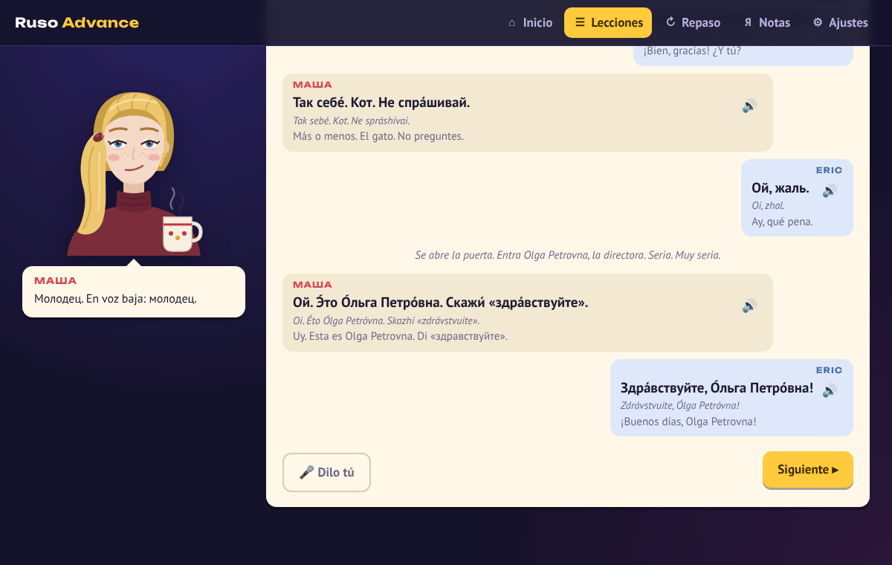
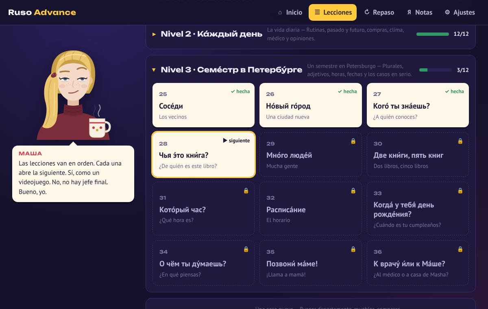

# Ruso Advance

Una app para aprender ruso en el navegador **conversando con Masha**: una profesora de San Petersburgo, medio enojona y bastante cínica, pero amable en el fondo. Vive con su gato Pelmén y toma demasiado té.

**Abrirla:** cuando esta rama se fusione con `main`, quedará en https://ontoterrorist.github.io/falacia-advance/ruso-advance/ (o en su propio repositorio, si se mueve ahí). También funciona en local con cualquier servidor estático.

## Cómo se aprende

Cada lección tiene cinco pasos:

1. **Escena**: dónde estás y qué pasa.
2. **Diálogo**: una conversación con Masha (y a veces con la directora, un camarero, una vendedora o un médico). Tú eliges qué responder; si te equivocas, Masha te lo dice a su manera.
3. **Frases clave**: lo que tienes que llevarte, con audio.
4. **Gramática**: una sola idea pequeña por lección, explicada en pocas líneas.
5. **Práctica**: ejercicios con lo nuevo, mezclados con un poco de repaso de lecciones anteriores.

Todo lo que practicas entra al **repaso con repetición espaciada** (una variante de SM-2, el algoritmo de Anki): si aciertas, la tarjeta vuelve más tarde (1 día, 3, 8, 20…); si fallas, vuelve pronto. La gramática también son tarjetas: cada vez sale con un ejemplo distinto, para entender la regla y no memorizar una frase. Los ejercicios se vuelven más difíciles a medida que la tarjeta madura: primero reconocer, después producir, luego escuchar, ordenar palabras y escribir en cirílico.

## Niveles

| Nivel | Lecciones | Gramática |
|---|---|---|
| 1 · Знакомство (Primeros encuentros) | Saludos, ¿cómo estás?, de dónde eres, ¿qué es esto?, no entiendo, ¿té o café? | Sin «ser», ты/вы, «из» + país, género, negación, quiero + acusativo |
| 2 · Мой мир (Mi mundo) | Familia, trabajo, edad, el café, ¿dónde está el metro?, gustos | у меня есть, verbos en -ать, мне … лет, можно, в/на + prepositivo, -ить y нравится |
| 3 · Каждый день (La vida diaria) | Mi día, ayer, mañana, ir a pie o en tren, la tienda, el clima | -ся, pasado, futuro con буду, идти/ехать, нет + genitivo, мне холодно |
| 4 · Настоящие разговоры (Conversaciones de verdad) | El médico, hay que estudiar, ¿ya lo hiciste?, opiniones, ¿con quién?, despedida | у меня болит, надо/можно/нельзя, aspecto, что/потому что/но, instrumental, imperativo |

24 lecciones, 201 frases, 102 tarjetas de conversación y 24 nociones de gramática con 132 ejercicios. También hay una sección con el alfabeto (con audio), que se puede añadir al repaso.

## Detalles

- **Voz**: usa la síntesis de voz del navegador en ruso. En Chrome, Edge y Safari suele venir incluida; si no aparece, hay que instalar la voz rusa del sistema. Masha mueve la boca cuando habla.
- **Micrófono** (opcional): en los navegadores que lo permiten (Chrome, Edge), el botón «Dilo tú» escucha tu pronunciación y Masha te dice qué entendió.
- **Acentos**: el ruso aparece con la sílaba tónica marcada (приве́т) y, si quieres, con transliteración pensada para hispanohablantes (х = j, privét).
- **Masculino o femenino**: al empezar eliges cómo quieres que te hable; tus frases cambian solas (я был / я была).
- **Teclado ruso en pantalla** para los ejercicios de escribir.
- **Atajos**: 1–4 para elegir, Intro para seguir, Espacio para volver a oír.

## Instalarla en el celular

Abre la página en el navegador del teléfono y añádela a la pantalla de inicio:

- **Android (Chrome):** menú ⋮ → «Instalar aplicación» o «Añadir a pantalla de inicio».
- **iPhone (Safari):** botón Compartir → «Añadir a pantalla de inicio».

Después de abrirla una vez funciona sin conexión (salvo la voz, que en algunos teléfonos necesita red). El progreso se guarda en el propio navegador; en Ajustes puedes descargar una copia y cargarla en otro dispositivo.

## Qué hay en este repositorio

No hace falta compilar nada: es una página estática.

- `index.html`, `styles.css`
- `app.js`: lecciones, repaso espaciado, ejercicios, voz y ajustes
- `data.js`: todo el contenido del curso (diálogos, frases, gramática y frases de Masha)
- `masha.js`: Masha en SVG, con ocho expresiones
- `sw.js` y `manifest.webmanifest`: para instalarla y usarla sin conexión
- `fonts/`: PT Sans y Unbounded (licencia SIL Open Font License), con cirílico

Para probarla en local: `npx http-server .` y abrir http://localhost:8080.
